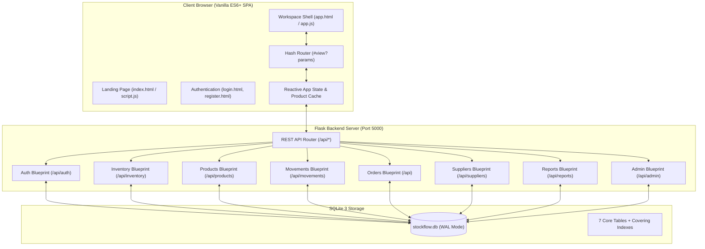

# Master Technical Specification & Architecture Blueprint: StockFlow

> **Document Name:** `ARCHITECTURE_BLUEPRINT_context.md`  
> **Project Identity:** **StockFlow** — High-Performance Retail Inventory, Point-of-Sale (POS) Billing & Operations Workspace.  
> **Source Baseline:** `frontend1/` (Complete working vanilla JavaScript Single-Page Application)  
> **Target Modular Structure:** `temp/frontend/`  
> **Production Destination:** `frontend/`  
> **Backend Service:** Flask (Python 3.10+) with SQLite 3 (WAL mode) at `http://127.0.0.1:5000`

---

## 1. System Overview & Technology Stack



### Core Architecture Principles
1. **Zero External Frontend Frameworks:** No React, Vue, Angular, or bundler requirement. Uses native ES6 modules, browser DOM APIs, and CSS custom properties.
2. **Deterministic Routing:** URL hash driven navigation (`#products?q=rice&page=2`) supporting browser history (`pushState` / `replaceState`), direct deep-linking, and bookmarking.
3. **Optimistic & Resilient Data Sync:** In-memory `productCache` (`Map<number, Product>`) prevents redundant network round-trips for combobox search, POS calculations, and live stock movement projections.
4. **Acid Compliance with SQLite WAL:** Backend database uses Write-Ahead Logging (`PRAGMA journal_mode=WAL`), foreign key enforcement (`PRAGMA foreign_keys=ON`), and covering indexes for microsecond-level query execution.

---

## 2. Complete Database Schema (`backend/database/schema.sql`)

```sql
PRAGMA foreign_keys = ON;

-- 1. USERS & IDENTITY
CREATE TABLE IF NOT EXISTS users (
    id INTEGER PRIMARY KEY AUTOINCREMENT,
    username TEXT UNIQUE NOT NULL COLLATE NOCASE,
    email TEXT UNIQUE NOT NULL COLLATE NOCASE,
    password_hash TEXT NOT NULL,
    full_name TEXT NOT NULL,
    role TEXT NOT NULL DEFAULT 'shopkeeper' CHECK (role IN ('admin', 'manager', 'shopkeeper', 'wholesaler', 'staff', 'user')),
    status TEXT NOT NULL DEFAULT 'active' CHECK (status IN ('active', 'suspended')),
    created_at TIMESTAMP DEFAULT CURRENT_TIMESTAMP,
    last_login TIMESTAMP
);

-- 2. SOURCING PARTNERS / SUPPLIERS
CREATE TABLE IF NOT EXISTS suppliers (
    id INTEGER PRIMARY KEY AUTOINCREMENT,
    code TEXT UNIQUE NOT NULL COLLATE NOCASE,
    name TEXT NOT NULL,
    tier TEXT NOT NULL DEFAULT 'Tier B' CHECK (tier IN ('Tier A', 'Tier B', 'Tier C')),
    contact_name TEXT,
    email TEXT,
    phone TEXT,
    lead_time_days INTEGER DEFAULT 7,
    rating REAL DEFAULT 4.5,
    status TEXT NOT NULL DEFAULT 'active' CHECK (status IN ('active', 'inactive')),
    created_at TIMESTAMP DEFAULT CURRENT_TIMESTAMP
);

-- 3. PRODUCT CATALOG
CREATE TABLE IF NOT EXISTS products (
    id INTEGER PRIMARY KEY AUTOINCREMENT,
    sku TEXT UNIQUE NOT NULL COLLATE NOCASE,
    name TEXT NOT NULL,
    category TEXT NOT NULL,
    unit_price REAL NOT NULL DEFAULT 0.0,
    current_stock INTEGER NOT NULL DEFAULT 0,
    min_stock INTEGER NOT NULL DEFAULT 10,
    max_stock INTEGER NOT NULL DEFAULT 500,
    supplier_id INTEGER,
    status TEXT NOT NULL DEFAULT 'in_stock' CHECK (status IN ('in_stock', 'low_stock', 'out_of_stock')),
    created_at TIMESTAMP DEFAULT CURRENT_TIMESTAMP,
    FOREIGN KEY (supplier_id) REFERENCES suppliers(id) ON DELETE SET NULL
);

-- 4. STOCK MOVEMENTS (Audit Ledger)
CREATE TABLE IF NOT EXISTS movements (
    id INTEGER PRIMARY KEY AUTOINCREMENT,
    product_id INTEGER NOT NULL,
    type TEXT NOT NULL CHECK (type IN ('INBOUND', 'OUTBOUND', 'ADJUSTMENT', 'TRANSFER')),
    quantity INTEGER NOT NULL,
    reference_no TEXT,
    performed_by TEXT,
    notes TEXT,
    created_at TIMESTAMP DEFAULT CURRENT_TIMESTAMP,
    FOREIGN KEY (product_id) REFERENCES products(id) ON DELETE CASCADE
);

-- 5. REPLENISHMENT PURCHASE ORDERS
CREATE TABLE IF NOT EXISTS purchase_orders (
    id INTEGER PRIMARY KEY AUTOINCREMENT,
    po_number TEXT UNIQUE NOT NULL COLLATE NOCASE,
    supplier_id INTEGER,
    status TEXT NOT NULL DEFAULT 'ordered' CHECK (status IN ('draft', 'ordered', 'received', 'cancelled')),
    total_cost REAL NOT NULL DEFAULT 0.0,
    notes TEXT,
    created_by TEXT,
    created_at TIMESTAMP DEFAULT CURRENT_TIMESTAMP,
    received_at TIMESTAMP,
    FOREIGN KEY (supplier_id) REFERENCES suppliers(id) ON DELETE SET NULL
);

CREATE TABLE IF NOT EXISTS purchase_order_items (
    id INTEGER PRIMARY KEY AUTOINCREMENT,
    purchase_order_id INTEGER NOT NULL,
    product_id INTEGER NOT NULL,
    quantity INTEGER NOT NULL,
    unit_cost REAL NOT NULL DEFAULT 0.0,
    FOREIGN KEY (purchase_order_id) REFERENCES purchase_orders(id) ON DELETE CASCADE,
    FOREIGN KEY (product_id) REFERENCES products(id) ON DELETE CASCADE
);

-- 6. POS SALES ORDERS & INVOICES
CREATE TABLE IF NOT EXISTS sales_orders (
    id INTEGER PRIMARY KEY AUTOINCREMENT,
    invoice_number TEXT UNIQUE NOT NULL COLLATE NOCASE,
    customer_name TEXT,
    customer_contact TEXT,
    payment_method TEXT NOT NULL DEFAULT 'cash' CHECK (payment_method IN ('cash', 'card', 'upi', 'bank_transfer')),
    status TEXT NOT NULL DEFAULT 'completed' CHECK (status IN ('completed', 'voided')),
    subtotal REAL NOT NULL DEFAULT 0.0,
    discount REAL NOT NULL DEFAULT 0.0,
    total_amount REAL NOT NULL DEFAULT 0.0,
    notes TEXT,
    created_by TEXT,
    created_at TIMESTAMP DEFAULT CURRENT_TIMESTAMP
);

CREATE TABLE IF NOT EXISTS sales_order_items (
    id INTEGER PRIMARY KEY AUTOINCREMENT,
    sales_order_id INTEGER NOT NULL,
    product_id INTEGER NOT NULL,
    quantity INTEGER NOT NULL,
    unit_price REAL NOT NULL DEFAULT 0.0,
    FOREIGN KEY (sales_order_id) REFERENCES sales_orders(id) ON DELETE CASCADE,
    FOREIGN KEY (product_id) REFERENCES products(id) ON DELETE CASCADE
);

-- 7. AUDIT & SYSTEM STATE
CREATE TABLE IF NOT EXISTS audit_logs (
    id INTEGER PRIMARY KEY AUTOINCREMENT,
    user_id INTEGER,
    username TEXT,
    action TEXT NOT NULL,
    details TEXT,
    ip_address TEXT,
    status TEXT NOT NULL DEFAULT 'success' CHECK (status IN ('success', 'failed', 'warning')),
    created_at TIMESTAMP DEFAULT CURRENT_TIMESTAMP,
    FOREIGN KEY (user_id) REFERENCES users(id) ON DELETE SET NULL
);

CREATE TABLE IF NOT EXISTS system_settings (
    key TEXT PRIMARY KEY,
    value TEXT NOT NULL,
    updated_at TIMESTAMP DEFAULT CURRENT_TIMESTAMP
);

CREATE TABLE IF NOT EXISTS user_sessions (
    id INTEGER PRIMARY KEY AUTOINCREMENT,
    token TEXT UNIQUE NOT NULL,
    user_id INTEGER NOT NULL,
    created_at TIMESTAMP DEFAULT CURRENT_TIMESTAMP,
    expires_at TIMESTAMP NOT NULL,
    FOREIGN KEY (user_id) REFERENCES users(id) ON DELETE CASCADE
);

-- COVERING INDEXES
CREATE INDEX IF NOT EXISTS idx_users_email ON users(email);
CREATE INDEX IF NOT EXISTS idx_users_username ON users(username);
CREATE INDEX IF NOT EXISTS idx_users_role_status ON users(role, status);
CREATE INDEX IF NOT EXISTS idx_user_sessions_token ON user_sessions(token);
CREATE INDEX IF NOT EXISTS idx_user_sessions_expires ON user_sessions(expires_at);
CREATE INDEX IF NOT EXISTS idx_products_sku ON products(sku);
CREATE INDEX IF NOT EXISTS idx_products_category ON products(category);
CREATE INDEX IF NOT EXISTS idx_products_status ON products(status);
CREATE INDEX IF NOT EXISTS idx_products_stock_min ON products(current_stock, min_stock);
CREATE INDEX IF NOT EXISTS idx_products_supplier ON products(supplier_id);
CREATE INDEX IF NOT EXISTS idx_suppliers_code ON suppliers(code);
CREATE INDEX IF NOT EXISTS idx_suppliers_tier_status ON suppliers(tier, status);
CREATE INDEX IF NOT EXISTS idx_movements_product ON movements(product_id);
CREATE INDEX IF NOT EXISTS idx_movements_type_created ON movements(type, created_at DESC);
CREATE INDEX IF NOT EXISTS idx_movements_created ON movements(created_at DESC);
CREATE INDEX IF NOT EXISTS idx_audit_logs_created ON audit_logs(created_at DESC);
CREATE INDEX IF NOT EXISTS idx_audit_logs_action ON audit_logs(action, created_at DESC);
CREATE INDEX IF NOT EXISTS idx_purchase_orders_status ON purchase_orders(status, created_at DESC);
CREATE INDEX IF NOT EXISTS idx_purchase_orders_supplier ON purchase_orders(supplier_id);
CREATE INDEX IF NOT EXISTS idx_po_items_po ON purchase_order_items(purchase_order_id);
CREATE INDEX IF NOT EXISTS idx_sales_orders_status_created ON sales_orders(status, created_at DESC);
CREATE INDEX IF NOT EXISTS idx_so_items_so ON sales_order_items(sales_order_id);
```

---

## 3. Exhaustive REST API Specification

All protected endpoints require HTTP Header: `Authorization: Bearer <token>`.
Standard Success JSON Response: `{ "success": true, "data": { ... } }`  
Standard Error JSON Response: `{ "success": false, "error": "Descriptive message", "errors": { "field": "error" } }`

### 3.1 Authentication & Profiles (`/api/auth`)
* `POST /api/auth/register`
  * Body: `{ "username": "store_admin", "email": "admin@store.com", "password": "securepassword", "full_name": "Store Admin", "role": "shopkeeper" }`
  * Response: `{ "success": true, "data": { "token": "...", "user": { ... } } }`
* `POST /api/auth/login`
  * Body: `{ "identifier": "admin@store.com", "password": "securepassword" }`
  * Response: `{ "success": true, "data": { "token": "...", "user": { ... } } }`
* `GET /api/auth/me`
  * Response: `{ "success": true, "data": { "user": { "id": 1, "username": "admin", "email": "...", "full_name": "...", "role": "admin", "status": "active" } } }`
* `POST /api/auth/logout`
  * Body: `{}` (Revokes session in `user_sessions`)
* `PATCH /api/auth/profile`
  * Body: `{ "full_name": "New Display Name" }`
* `POST /api/auth/change-password`
  * Body: `{ "current_password": "old", "new_password": "newpass" }`

### 3.2 Inventory & System Overview (`/api/inventory`)
* `GET /api/inventory/overview`
  * Response: `{ "total_items": 248, "total_stock": 4820, "total_value": 14820.50, "out_of_stock_count": 2, "low_stock_count": 5, "currency": "USD" }`
* `GET /api/inventory/alerts`
  * Response: `{ "alerts": [ { "id": 12, "sku": "BEV-001", "name": "Green Tea", "category": "Beverages", "current_stock": 2, "min_stock": 10, "max_stock": 50, "suggested_reorder": 48 } ] }`
* `GET /api/inventory/settings`
  * Response: `{ "settings": { "company_name": "StockFlow Store", "currency": "USD", "default_low_stock_threshold": "15", "enable_realtime_alerts": "true", "items_per_page": "15", "cluster_region": "local-store", "backup_schedule": "daily_2200_close" } }`
* `PUT /api/inventory/settings` (or `POST`)
  * Body: `{ "company_name": "...", "currency": "INR", "default_low_stock_threshold": "20", "items_per_page": "25" }`
  * Restricted: `admin`, `manager`, `shopkeeper`
* `POST /api/inventory/convert-prices`
  * Body: `{ "target_currency": "EUR", "rate": 0.92 }`
  * Response: `{ "success": true, "products_updated": 248, "currency": "EUR" }`

### 3.3 Product Catalog (`/api/products`)
* `GET /api/products`
  * Query: `?page=1&limit=15&search=rice&category=Grains&status=in_stock`
  * Response: `{ "products": [...], "total": 42, "page": 1, "total_pages": 3, "categories": ["Grains", "Home Care", "Beverages"] }`
* `GET /api/products/<id>`
  * Response: Single product object with linked `supplier_name` and `supplier_code`.
* `POST /api/products`
  * Body: `{ "sku": "GR-010", "name": "Brown Rice 1kg", "category": "Grains", "unit_price": 4.50, "current_stock": 20, "min_stock": 5, "max_stock": 100, "supplier_id": 1 }`
* `PUT /api/products/<id>` (or `PATCH`)
  * Body: Updated fields. Enforces `max_stock >= min_stock` and non-negative numbers.
* `DELETE /api/products/<id>`
  * Restricted: `admin`, `manager`.
* `GET /api/products/export`
  * Query: Filters matching `GET /api/products`.
  * Response: Direct CSV file stream (`Content-Disposition: attachment; filename="stockflow-products.csv"`).
* `POST /api/products/import`
  * `multipart/form-data`: `file: <csv>`, `mode: "merge" | "replace"`
  * Response: `{ "inserted": 10, "updated": 4, "skipped": 0, "error_count": 0 }`

### 3.4 Stock Movements Ledger (`/api/movements`)
* `GET /api/movements`
  * Query: `?page=1&limit=15&search=&type=INBOUND&start_date=2026-01-01&end_date=2026-02-01`
  * Response: `{ "movements": [ { "id": 1, "product_id": 10, "product_name": "Rice", "sku": "GR-001", "type": "INBOUND", "quantity": 50, "reference_no": "PO-101", "performed_by": "admin", "notes": "Received", "created_at": "..." } ], "total": 120, "page": 1, "total_pages": 8 }`
* `POST /api/movements`
  * Body: `{ "product_id": 10, "type": "INBOUND|OUTBOUND|ADJUSTMENT|TRANSFER", "quantity": 10, "reference_no": "REF-123", "notes": "Restock", "target_product_id": 12 }`
  * Atomic database transaction updating `products.current_stock` and setting status (`in_stock`, `low_stock`, `out_of_stock`).
* `GET /api/movements/export`
  * Response: CSV file stream.
* `POST /api/movements/import`
  * `multipart/form-data`: `file: <csv>`, `mode: "merge" | "replace"`, `apply_stock: "true" | "false"`

### 3.5 Purchase Orders & Replenishment (`/api/purchase-orders`)
* `GET /api/purchase-orders`
  * Query: `?page=1&limit=15&search=&status=ordered`
  * Response: `{ "purchase_orders": [ { "id": 1, "po_number": "PO-2026-001", "supplier_id": 2, "supplier_name": "Fresh Direct", "status": "ordered", "total_cost": 450.00, "notes": "...", "created_at": "...", "items": [...] } ], "total": 12 }`
* `POST /api/purchase-orders`
  * Body: `{ "supplier_id": 2, "notes": "Monthly restock", "items": [ { "product_id": 10, "quantity": 50, "unit_cost": 2.20 } ] }`
* `POST /api/purchase-orders/<id>/receive`
  * Atomically sets status to `received`, logs received timestamp, and records `INBOUND` movements for all line items.
* `POST /api/purchase-orders/<id>/cancel`
  * Body: `{ "reason": "Supplier out of stock" }`

### 3.6 Sales Billing & Invoices (`/api/sales-orders`)
* `GET /api/sales-orders`
  * Query: `?page=1&limit=15&search=&status=completed&start_date=&end_date=`
  * Response: `{ "sales_orders": [ { "id": 5, "invoice_number": "INV-2026-089", "customer_name": "John Doe", "customer_contact": "555-0199", "payment_method": "cash", "status": "completed", "subtotal": 120.00, "discount": 10.00, "total_amount": 110.00, "items": [...] } ], "total": 85 }`
* `POST /api/sales-orders`
  * Body: `{ "customer_name": "Jane", "customer_contact": "...", "payment_method": "card", "discount": 5.00, "notes": "", "items": [ { "product_id": 10, "quantity": 2, "unit_price": 15.00 } ] }`
  * Pre-flight checks inventory levels; deducts stock; writes `sales_orders`, `sales_order_items`, and `movements` (type `OUTBOUND`).
* `POST /api/sales-orders/<id>/void`
  * Body: `{ "reason": "Customer returned goods" }`
  * Restores inventory quantities to `products` and records compensating `ADJUSTMENT` movement entries.

### 3.7 Suppliers (`/api/suppliers`)
* `GET /api/suppliers`
  * Query: `?search=&tier=Tier A&status=active`
  * Response: `{ "suppliers": [ { "id": 1, "code": "SUP-01", "name": "Fresh Farms", "tier": "Tier A", "contact_name": "Alice", "email": "...", "phone": "...", "lead_time_days": 3, "rating": 4.8, "managed_products": 14 } ] }`
* `POST /api/suppliers`
  * Body: `{ "code": "SUP-02", "name": "Green Logistics", "tier": "Tier B", "lead_time_days": 5, "rating": 4.2 }`
* `PUT /api/suppliers/<id>`: Update supplier.
* `DELETE /api/suppliers/<id>`: Restricted to `admin` / `manager`.

### 3.8 Reports (`/api/reports/summary`)
* `GET /api/reports/summary?category=all&start_date=2026-01-01&end_date=2026-02-01`
  * Response:
    ```json
    {
      "currency": "USD",
      "totals": { "total_products": 248, "total_units": 4820, "total_value": 14820.50, "total_movements": 142 },
      "categories": [ { "category": "Grains", "product_count": 32, "total_units": 1200, "total_value": 4800.00 } ],
      "sales_summary": { "total_orders": 85, "units_sold": 340, "net_revenue": 5600.00 },
      "purchase_summary": { "total_orders": 12, "received_count": 10, "total_spend": 3200.00 },
      "supplier_performance": [ { "tier": "Tier A", "managed_products": 45, "avg_rating": 4.8 } ],
      "movements": [ { "type": "INBOUND", "count": 60, "net_quantity": 2500 } ]
    }
    ```

### 3.9 Administration & Security (`/api/admin`)
* `GET /api/admin/metrics`: Platform health and activity.
* `GET /api/admin/users`: User management list.
* `POST /api/admin/users`: `{ "full_name": "...", "username": "...", "email": "...", "role": "manager", "password": "..." }`
* `PATCH /api/admin/users/<id>/role`: `{ "role": "manager" }`
* `PATCH /api/admin/users/<id>/status`: `{ "status": "suspended" | "active" }`
* `DELETE /api/admin/users/<id>`: Remove user account.
* `GET /api/admin/audit-logs`: `?limit=50&filter=` security and action log stream.

---

## 4. Complete Frontend Architecture

### 4.1 State Tree & Reactive Store (`modules/state.js`)
```javascript
export const state = {
  user: null, // Logged in user profile
  settings: {
    company_name: 'StockFlow Store',
    currency: 'USD',
    default_low_stock_threshold: '15',
    enable_realtime_alerts: 'true',
    items_per_page: '15',
    cluster_region: 'local-store',
    backup_schedule: 'daily_2200_close'
  },
  view: 'dashboard',
  // Products
  products: [],
  categories: [],
  productTotal: 0,
  productPage: 1,
  productSearch: '',
  productCategory: 'all',
  productStatus: 'all',
  // Suppliers
  suppliers: [],
  allSuppliers: [], // Cached complete list for dropdowns
  supplierSearch: '',
  supplierTier: 'all',
  supplierStatus: 'all',
  // Movements
  movements: [],
  movementTotal: 0,
  movementPage: 1,
  movementSearch: '',
  movementType: 'all',
  movementStartDate: '',
  movementEndDate: '',
  // Alerts
  alerts: [],
  alertSearch: '',
  alertSeverity: 'all',
  alertCategory: 'all',
  // Purchase Orders
  purchaseOrders: [],
  poTotal: 0,
  poPage: 1,
  poSearch: '',
  poStatus: 'all',
  // Sales Orders
  salesOrders: [],
  salesTotal: 0,
  salesPage: 1,
  salesSearch: '',
  salesStatus: 'all',
  salesStartDate: '',
  salesEndDate: '',
  // Reports & Admin
  reportData: null,
  adminTab: 'users',
  adminUsers: [],
  auditLogs: [],
  // High-performance cache & anti-race conditions
  productCache: new Map(), // Map<id, Product>
  reqSeq: { products: 0, movements: 0, suppliers: 0, purchases: 0, sales: 0 }
};
```

### 4.2 Role Permissions Matrix
| Role | View Catalog | Edit Catalog | Record Movements | POS Sales | Manage Settings | Team Administration |
| :--- | :---: | :---: | :---: | :---: | :---: | :---: |
| **admin** | ✅ | ✅ | ✅ | ✅ | ✅ | ✅ |
| **manager** | ✅ | ✅ | ✅ | ✅ | ✅ | ❌ |
| **shopkeeper** | ✅ | ✅ | ✅ | ✅ | ✅ | ❌ |
| **wholesaler** | ✅ | ❌ | Inbound Only | ✅ | ❌ | ❌ |
| **staff** | ✅ | ❌ | ✅ | ✅ | ❌ | ❌ |

---

## 5. UI Components & Feature Specifications

### 5.1 Modal Manager & Dialog Controller
* Operates native `<dialog id="entity-modal">`.
* `openModal(title, contentMarkup, { wide = false })`: Sets header eyebrow, title, close trigger, binds keyboard ESC listener.
* `openConfirmModal({ title, message, confirmLabel, danger, onConfirm })`: Reusable prompt for destructive operations (delete SKU, delete user, void invoice).
* `closeModal()`: Safely closes dialog and cleans up inner HTML.

### 5.2 Product Search Combobox (`mountProductCombobox`)
* Injects a real-time predictive search input.
* Searches through both local `state.productCache` and debounced backend queries.
* Keyboard accessible: Arrow keys navigation, Enter to pick, Escape to dismiss list.
* Displays SKU badge, current stock, and category in dropdown results.

### 5.3 Point-of-Sale (POS) Multi-line Billing Form
* Dynamic line items: Product combobox, quantity input, unit price input, remove line button.
* Auto-fills catalog price upon product selection.
* Live calculation of Subtotal, Discount deduction, and Net Payable.
* Live inventory pre-flight validation: Highlights row in red if requested units exceed `current_stock`.

### 5.4 Stock Movement Modal with Balance Projection
* Select movement type: `INBOUND`, `OUTBOUND`, `ADJUSTMENT`, `TRANSFER`.
* Real-time preview card:
  * For `INBOUND`: Shows `current_stock → (current_stock + qty)`.
  * For `OUTBOUND`: Shows `current_stock → (current_stock - qty)`. Warns if remaining stock $\le$ `min_stock` or triggers error if negative.
  * For `ADJUSTMENT`: Shows signed calculation. Requires mandatory notes.
  * For `TRANSFER`: Reveals second "Destination Product" combobox. Enforces source SKU $\neq$ target SKU.

---

## 6. CSS System & Design Tokens

### 6.1 Color Palette & Design Tokens
```css
:root {
  --bg: #f7f8f6;
  --paper: #ffffff;
  --ink: #171b19;
  --muted: #737a75;
  --line: #e4e8e4;
  --green: #246b4b;
  --green-dark: #163f2f;
  --lime: #d8f06e;
  --blue: #eaf2f3;
  --cream: #f5eee2;
  --danger: #b13d34;
  --warning: #a75832;
  --success: #36642b;
  --radius: 20px;
  --shadow: 0 26px 80px rgba(25, 48, 36, 0.12);
  --container: min(1180px, calc(100% - 64px));
}

[data-theme="dark"] {
  --bg: #0d1712;
  --paper: #15241c;
  --ink: #e7eee9;
  --muted: #829689;
  --line: #23382c;
  --green: #328e62;
  --green-dark: #1f5d40;
  --lime: #d8f06e;
  --shadow: 0 26px 80px rgba(0, 0, 0, 0.45);
}
```

### 6.2 Mobile Responsive Table Collapse (@media max-width: 860px)
* Tables switch from `display: table` to a card grid (`display: grid; gap: 10px`).
* `thead` is hidden.
* Every cell renders its column header on mobile using CSS `attr(data-label)`:
  ```css
  .table-panel td[data-label]::before {
    content: attr(data-label);
    display: block;
    color: var(--muted);
    font: 600 9px 'DM Mono', monospace;
    text-transform: uppercase;
    letter-spacing: .06em;
    margin-bottom: 3px;
  }
  ```

---

## 7. Migration & Modular Mapping

Transforming `frontend1/` into the target `temp/frontend/` layout:

```text
SOURCE FILE (frontend1/)              TARGET DESTINATION (frontend/)
-----------------------------------+---------------------------------------------------------
style.css (minified)               -> css/pages/landing.css (unminified, formatted)
login.css & register.css (minified)-> css/pages/auth.css (merged & unminified)
app.css (1009 lines)               -> css/main.css (tokens & reset) & css/pages/app.css
(new print styles)                 -> css/pages/print.css (dedicated print stylesheet)
api-client.js                      -> js/api/client.js (enhanced with retry & interceptors)
modules/state.js                   -> js/state/store.js (reactive state + dark theme toggle)
modules/formatters.js              -> js/utils/formatters.js (currency, dates, CSV download)
modules/ui.js                      -> js/components/ui.js (modal, combobox, pagination, toasts)
modules/views-inventory.js         -> js/features/products/view.js, form.js
                                   -> js/features/movements/view.js, form.js
modules/views-operations.js        -> js/features/suppliers/view.js, form.js
                                   -> js/features/purchases/view.js
                                   -> js/features/sales/view.js, form.js
                                   -> js/features/reports/view.js
modules/views-admin.js             -> js/pages/admin.js (settings, team admin, profile, CSV)
script.js                          -> js/pages/landing.js
login.js                           -> js/pages/login.js
register.js                        -> js/pages/register.js
app.js                             -> app.js (root entry router & event dispatcher)
HTML files (4 files)               -> root HTML files updated with new asset paths
```

---

## 8. Verification & Test Checklist

1. **Static Routing & Asset Serving:** Verify `backend/app.py` serves `frontend/` without 404s.
2. **Authentication Flow:** Verify registration, login token persistence, profile name updates, password changes, and clean logout.
3. **Product Management:** Test SKU creation, editing, category filters, and CSV bulk import/export.
4. **Movement Ledger & Math:** Verify `INBOUND`, `OUTBOUND`, manual `ADJUSTMENT`, and cross-SKU `TRANSFER` update product stock balances accurately.
5. **POS Billing:** Verify line item calculations, subtotal/discount math, stock availability checks, invoice printing, and invoice voiding.
6. **Responsive Layouts:** Verify mobile collapsible sidebar, touch drawer, card-collapsed tables, and modal dialogs on viewports down to 360px.
