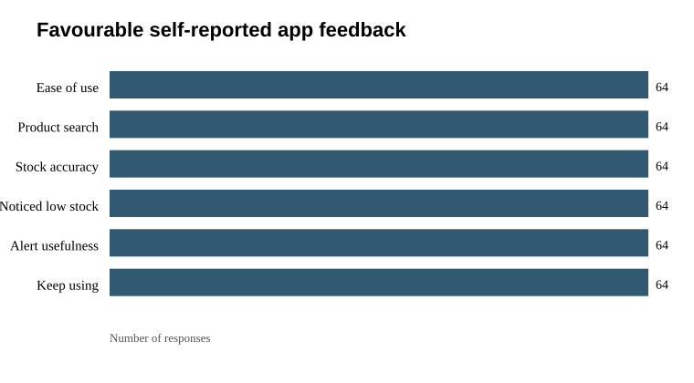

# App feedback summary and preliminary comparison

**Source:** `Inventory App — User Feedback Responses.csv` | **Responses:** 64.

## Feedback ratings

### How easy was the app to use?

| Answer | Responses | Share |
| --- | --- | --- |
| Very easy | 33 | 51.6% |
| Easy | 31 | 48.4% |

### How easy was it to find a product?

| Answer | Responses | Share |
| --- | --- | --- |
| Very easy | 37 | 57.8% |
| Easy | 27 | 42.2% |

### How accurate were the stock quantities shown in the app?

| Answer | Responses | Share |
| --- | --- | --- |
| Very accurate | 35 | 54.7% |
| Mostly accurate | 29 | 45.3% |

### Did the app help you notice low stock sooner?

| Answer | Responses | Share |
| --- | --- | --- |
| Yes, a lot | 60 | 93.8% |
| A little | 3 | 4.7% |
| Somewhat | 1 | 1.6% |

### How useful were the low-stock alerts?

| Answer | Responses | Share |
| --- | --- | --- |
| Very useful | 60 | 93.8% |
| Somewhat useful | 4 | 6.2% |

### How likely are you to keep using the app?

| Answer | Responses | Share |
| --- | --- | --- |
| Definitely | 60 | 93.8% |
| Probably | 4 | 6.2% |

## Open-ended feature requests

Theme counts use a simple keyword pass and are non-exclusive; inspect the responses before treating them as final qualitative coding.

| Theme | Responses |
| --- | --- |
| Dark mode / night use | 18 |
| Stock movement charts / reports | 20 |
| Multi-user / roles | 14 |
| Other / review needed | 18 |

## Preliminary comparison with the initial survey

The exports contain **62 matching names** across the initial survey and app feedback. The anonymised files use the same randomly assigned pseudonymous ID for matching names, but each CSV has repeat rows for one ID. This is a possible respondent-level link, not proof that the same people provided both answers or completed a controlled test. The ID map is not saved; rerunning the script generates different IDs.

Descriptively, the initial survey records current-process stock-management problems and satisfaction; the follow-up records opinions after app use. The answers can be compared as reported needs versus perceived app usefulness, but there are no paired task-time, error, or completion measurements here. Therefore this comparison cannot establish that the prototype improved performance.

## Data quality and limits

- Two participants have repeated rows in the follow-up export; repeated rows were retained under the same participant ID. Check for duplicate submissions.
- 60/64 respondents selected “Yes, a lot” for noticing low stock sooner and 60/64 rated alerts “Very useful.” These are strongly positive self-reports; provide recruitment and collection context and avoid overstating them.
- Timestamps in both raw exports are clustered within a few minutes. Timing alone does not establish whether responses are invalid, but collection method and authenticity should be confirmed.
- Names, location fields, and timestamps are omitted from the anonymised copies. The source exports remain unchanged and still contain personal information; restrict access to them.
- No SUS questionnaire, current-method-versus-prototype task measures, sampling details, or testing protocol are in these files.
