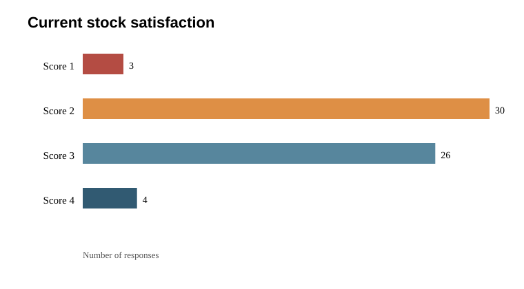

# Initial inventory survey analysis

**Source:** `painpoints1.csv` | **Responses:** 63 | **Distinct participants by source name:** 62.

## Key result

Current-system satisfaction averaged **2.49/4** (median 2; mode 2; sample SD 0.69; approximate 95% CI for the mean 2.32–2.67). 33/63 respondents rated satisfaction below 3. The mean and confidence interval treat the 1–4 ratings as equally spaced; the survey does not provide scale anchors. The survey suggests dissatisfaction, but it does not establish a causal explanation.

## Satisfaction distribution

| Score | Responses | Share |
| --- | --- | --- |
| 1 | 3 | 4.8% |
| 2 | 30 | 47.6% |
| 3 | 26 | 41.3% |
| 4 | 4 | 6.3% |

## Businesses represented

| Business type | Responses |
| --- | --- |
| Hardware | 15 |
| Grocery | 13 |
| Clothing | 11 |
| Pharmacy | 7 |
| Stationery | 7 |
| Electronics/mobile | 6 |
| Other | 4 |

## Current stock-management methods

| Reported method/combination | Responses |
| --- | --- |
| Billing/POS software | 15 |
| Spreadsheet | 13 |
| Notebook | 12 |
| Notebook, Mix | 6 |
| Mix | 4 |
| Spreadsheet, Billing/POS software | 3 |
| Spreadsheet, Mix | 3 |
| Billing/POS software, Spreadsheet | 2 |
| Notebook, Spreadsheet | 2 |
| Billing/POS software, Mix | 1 |
| Memory/verbal communication | 1 |
| Memory/verbal communication, Notebook | 1 |

## Reported problems

| Reported response / combination | Responses |
| --- | --- |
| Late low-stock discovery, Slow stock updates | 9 |
| Wrong quantities, No stock history | 8 |
| Slow stock updates, Wrong quantities | 6 |
| Wrong quantities, Slow stock updates | 5 |
| Hard to find products, Late low-stock discovery | 4 |
| Hard to find products, Wrong quantities | 4 |
| Late low-stock discovery, Wrong quantities | 4 |
| Slow stock updates, Late low-stock discovery | 4 |
| Hard to find products, Slow stock updates | 3 |
| Slow stock updates, Hard to find products | 3 |
| Slow stock updates, No stock history | 3 |
| Wrong quantities, Late low-stock discovery | 3 |
| Wrong quantities, Hard to find products | 2 |
| Hard to find products, No stock history | 1 |
| Late low-stock discovery | 1 |
| Late low-stock discovery, Hard to find products | 1 |
| No stock history, Late low-stock discovery | 1 |
| No stock history, Wrong quantities | 1 |

## Baseline hypothesis test (exploratory)

H0: Among ratings other than 3, a score below 3 is no more likely than a score above 3 (each has probability 0.5). H1: A score below 3 is more likely. Exact one-sided sign test: 33/37 non-3 responses below 3; p = 5.42e-07. The score threshold is exploratory because the response scale anchors and a pre-collection hypothesis were not supplied.

## Correlation

Pearson correlation between satisfaction score and selecting “Late low-stock discovery” as a problem: r = -0.107 (n=63). This is an exploratory association; the issue variable is binary and satisfaction is ordinal, so interpret cautiously.

## Data and limits

- Two rows share the same name in the initial export; both are retained in the anonymised file under the same participant ID. Confirm whether these are repeat submissions before treating rows as independent.
- The export does not include a sampling plan, recruitment details, survey scale anchors, or evidence that questions and hypotheses were planned before collection.
- Ratings are self-reported. This survey alone cannot show that the app improves task performance.
- Identifiers and timestamps were removed from the analysis copy. No name-to-ID key was saved.
